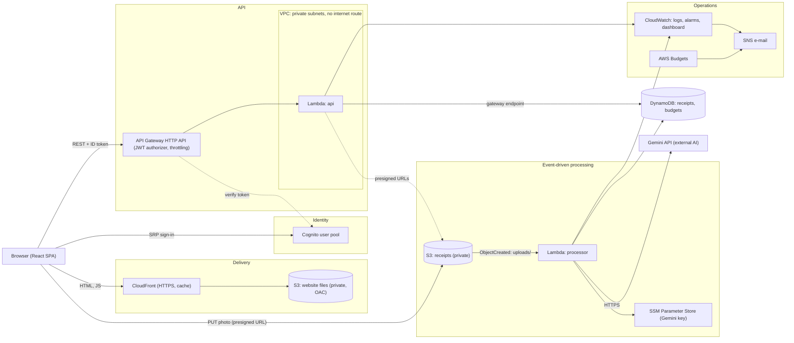
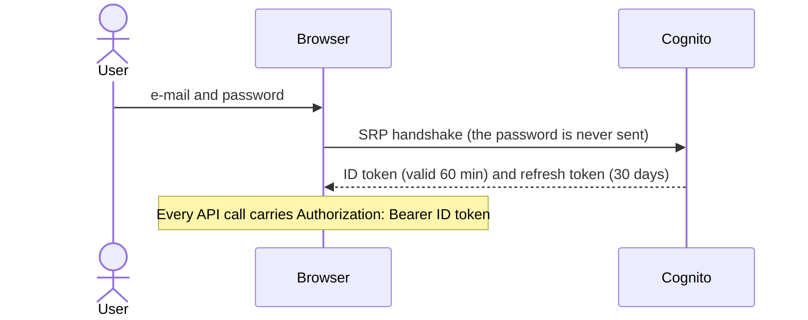
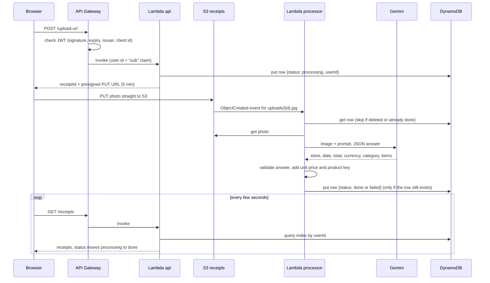
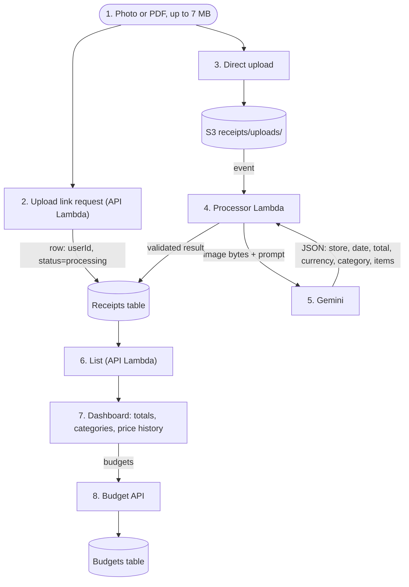
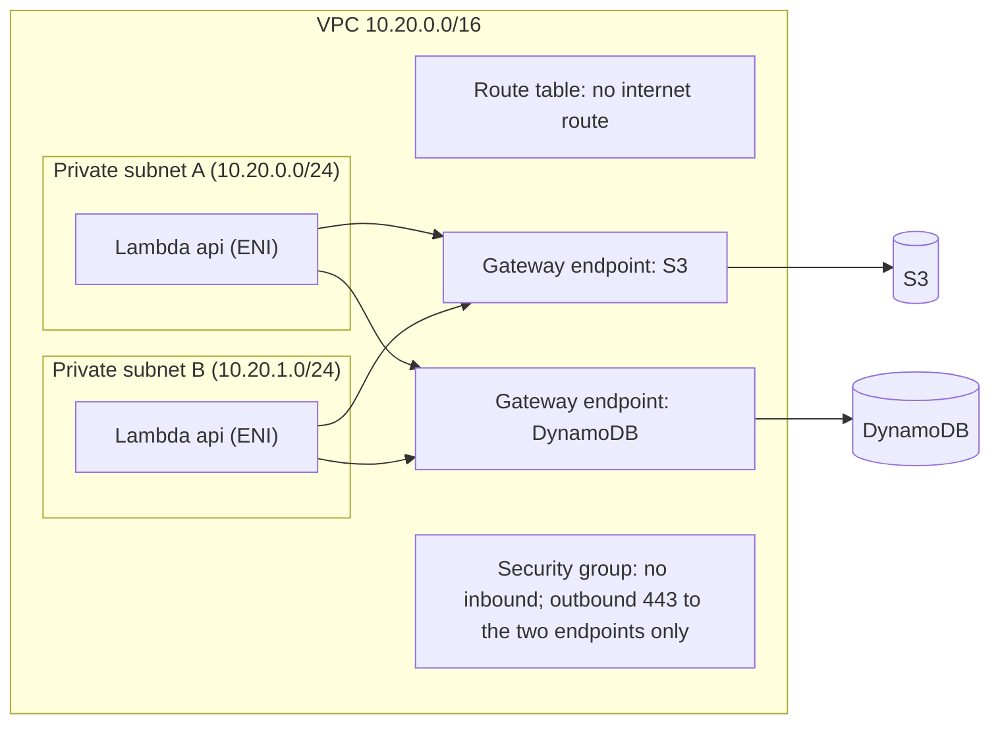

# Architecture

receipt-scanner is an event-driven, serverless application on AWS. A user signs in, uploads a photo (or PDF) of a
receipt, Gemini reads it, and a dashboard shows where the money goes and how product prices change. Everything is
created by Terraform; the application code is two small Lambda functions and a React single-page app.

- [System architecture](#1-system-architecture)
- [Cloud services used](#2-cloud-services-used)
- [Service interaction flows](#3-service-interaction-flows)
- [Data flow](#4-data-flow)
- [Data model](#5-data-model)
- [Network design](#6-network-design)
- [Security considerations](#7-security-considerations)
- [Scalability and reliability](#8-scalability-and-reliability)
- [Infrastructure as code](#9-infrastructure-as-code)
- [Design decisions and known limitations](#10-design-decisions-and-known-limitations)

Operational documents: [setup-guide.md](setup-guide.md), [cost-analysis.md](cost-analysis.md),
[monitoring.md](monitoring.md), [troubleshooting.md](troubleshooting.md), [demo-script.md](demo-script.md).

## 1. System architecture



The two Lambda functions are the only code that runs on the server side.

## 2. Cloud services used

The assignment asks for at least four integrated services. This project integrates twelve AWS services and the
Gemini API:

| Layer | Service | What it does here | Terraform |
|---|---|---|---|
| Compute | **Lambda** (`api`) | CRUD for receipts and budgets, creates upload links | `modules/api` |
| Compute | **Lambda** (`processor`) | Triggered by S3; asks Gemini to read the receipt, saves the result | `modules/processor` |
| API | **API Gateway** (HTTP API) | Public REST endpoint, JWT check before any code runs, rate limiting | `modules/api` |
| Identity | **Cognito** | Accounts, passwords, tokens | `modules/auth` |
| Storage | **S3** (receipts) | Private bucket for photos; browser uploads straight to it | `modules/storage` |
| Storage | **S3** (site) + **CloudFront** | The website, served over HTTPS from a private bucket | `modules/frontend` |
| Database | **DynamoDB** (2 tables) | Receipts (with a per-user index) and monthly budgets | `modules/storage` |
| AI | **Gemini API** | Reads store, date, total, currency, category and product lines from the image | `modules/processor` |
| Secrets | **SSM Parameter Store** | Holds the Gemini API key (SecureString), never in code or state | `modules/processor` |
| Network | **VPC**, subnets, security group, gateway endpoints | Private network for the API Lambda | `modules/network` |
| Access control | **IAM** | One least-privilege role per Lambda | `modules/api`, `modules/processor` |
| Monitoring | **CloudWatch** (logs, metrics, alarms, dashboard) | Visibility and alerts | `modules/monitoring` |
| Alerting | **SNS** | E-mail for alarms | `modules/monitoring` |
| Cost control | **AWS Budgets** | Warning before the free tier is used up | `modules/monitoring` |

## 3. Service interaction flows

### 3.1 Sign-in



### 3.2 Uploading and reading a receipt (the AI path)



### 3.3 Viewing, editing, deleting

`GET /receipts/{id}/image` returns a five-minute presigned link, so the private bucket is never opened to the public.
`PATCH` and `DELETE` look the receipt up first and then write with a DynamoDB condition (`userId = :uid`), so the
ownership check is enforced twice: once in code and once inside the database.

## 4. Data flow



What leaves AWS: only the receipt image and the extraction prompt, sent over HTTPS to the Gemini API. The API key is
read from SSM at run time and cached for the life of the warm Lambda.

## 5. Data model

**Receipts table** (`receiptId` is the hash key; index `userId-createdAt-index` lists one user's receipts newest first)

| Attribute | Meaning |
|---|---|
| `receiptId` | random 32-hex id, also the S3 file name |
| `userId` | Cognito `sub` of the owner |
| `status` | `processing`, `done` or `failed` |
| `imageKey` | `uploads/{receiptId}.jpg` (or png, webp, pdf) |
| `store`, `date`, `total`, `currency`, `category` | what Gemini read; the user may correct them (`edited: true`) |
| `items[]` | product lines: `name`, `quantity`, `unit`, `price`, `unitPrice`, `key` |
| `error` | short reason when `status = failed` |

`items[].key` is a normalized product name (lower case, pack sizes removed, words sorted). It is computed in code,
not by the AI, so the same product on two receipts always gets the same key and its price history is consistent.

**Budgets table**: one row per user, `{ currency: { category: monthly limit } }`.

## 6. Network design



- The API Lambda talks only to S3 and DynamoDB, so it lives in two private subnets (two availability zones) with
  **no internet gateway and no NAT gateway**. S3 and DynamoDB are reached through free *gateway endpoints*.
- The security group allows **no inbound traffic** and outbound HTTPS only to the prefix lists of those two endpoints.
- The **processor Lambda is deliberately outside the VPC**. It must call the Gemini API on the internet, and a Lambda
  in a private subnet would need a NAT gateway for that (roughly 30 USD a month), which breaks the free-tier
  constraint. It is protected by IAM instead: it can read only `uploads/*` in one bucket, read and write one table, and
  read one SSM parameter.
- `enable_vpc = false` in the tfvars removes the network module and runs the API Lambda outside a VPC.

## 7. Security considerations

| Area | Measure |
|---|---|
| Authentication | Cognito; SRP sign-in (password never travels); `prevent_user_existence_errors`; token revocation on sign-out; password policy of 10+ characters |
| Authorization at the edge | Every API route uses the JWT authorizer: a request without a valid token never invokes Lambda (and costs nothing) |
| Tenant isolation | The user id comes only from the verified token. Lookup by id, then a check of `userId`; a receipt of another user answers **404**, identical to a missing one. Writes carry a DynamoDB condition on `userId` |
| Least privilege IAM | Separate role per Lambda, resource-level ARNs, `s3:*Object` limited to `uploads/*`, Query allowed only on the user index |
| Secrets | Gemini key in SSM SecureString, created with the AWS CLI, so it is never in Terraform code or state. `*.tfvars` is git-ignored (only `envs/*.tfvars` are committed) |
| Data at rest | S3 buckets private with all four public-access blocks; website bucket readable only by its CloudFront distribution (origin access control); DynamoDB and S3 encrypted by AWS defaults; the state bucket uses AES-256 and versioning |
| Data in transit | HTTPS only: CloudFront redirects HTTP, API Gateway and S3 presigned URLs are HTTPS, the state bucket denies non-TLS access |
| Input validation | Allowed content types (JPEG, PNG, WebP, PDF), 7 MB limit, strict id format (`[0-9a-f]{32}`), field whitelist and range checks on `PATCH`/`PUT`, the model's JSON answer validated before saving |
| Browser security | CORS allows only the CloudFront site (plus `localhost` in dev, `[]` in prod); the AWS managed security-headers policy on CloudFront; API responses `Cache-Control: no-store` |
| Abuse and cost protection | API Gateway throttling (5 requests/s, burst 10); presigned URLs valid 5 minutes and bound to one key and content type; self sign-up disabled by default |
| Environment separation | `envs/dev.tfvars` and `envs/prod.tfvars`; prod disables the simple password flow and local origins and turns on Cognito deletion protection |
| Auditability | Everything is in Terraform and Git; CloudWatch logs kept 14 days; resources are tagged `Project`, `Environment`, `ManagedBy` |

Privacy note: receipt images are sent to Google's Gemini API. On the free tier Google may use submitted content to
improve its products (check the current terms). Use test receipts for demos and do not upload documents with personal data.

## 8. Scalability and reliability

- **Scaling**: Lambda, API Gateway, S3, CloudFront and Cognito scale on demand with no servers to size. DynamoDB uses
  provisioned capacity (11 read and 11 write units per environment) to stay inside the always-free allowance; switching
  `billing_mode` to `PAY_PER_REQUEST` removes that ceiling when the free tier no longer matters.
- **Back-pressure**: the 5 requests/s API throttle protects Gemini's free quota. It is a variable of the module, not a
  hard limit of the design.
- **Asynchronous processing**: the upload returns immediately; reading happens in the background and the page polls. A
  slow or failing AI call never blocks the user.
- **Idempotency**: the processor skips receipts that are deleted or already `done`, and writes with
  `attribute_exists(receiptId)`, so a retried or duplicate S3 event cannot recreate a deleted receipt or read it twice.
- **Failure handling**: the processor never raises on a bad photo (S3 would retry and burn the AI quota). The failure
  is stored on the receipt with a readable reason, and the user can delete it or upload again.
- **Availability**: all services are managed and multi-AZ; the API Lambda is spread over two availability zones.
- **Recovery**: the state is versioned in S3; the whole environment can be rebuilt with `terraform apply`.

## 9. Infrastructure as code

```
terraform/
├── main.tf               wires the modules together, shared locals (allowed origins, frontend config)
├── variables.tf          region, environment, model, sign-up, VPC, alert e-mail, budget
├── outputs.tf            site_url, api_url, user_pool_id, dashboard_name, ...
├── backend.tf.example    remote state (S3, native lock file); copy to backend.tf to enable
├── envs/
│   ├── dev.tfvars
│   └── prod.tfvars       environment-specific configuration
├── bootstrap/            one-time: creates the S3 bucket that stores the state
└── modules/
    ├── network/          VPC, private subnets, gateway endpoints, security group
    ├── storage/          receipts bucket, DynamoDB tables
    ├── processor/        S3-triggered Lambda, IAM, SSM key lookup
    ├── auth/             Cognito user pool and app client
    ├── api/              HTTP API, JWT authorizer, API Lambda, IAM
    ├── frontend/         site bucket, CloudFront, files, runtime config.json
    └── monitoring/       SNS, alarms, dashboard, budget
```

- **Modules** have typed, documented variables and explicit outputs; the root passes values between them
  (`module.storage.bucket_arn` into `processor` and `api`), so there are no copied ARNs or names.
- **State**: remote state in a versioned, encrypted S3 bucket with a native lock file (Terraform 1.10+); one state key
  per environment (`dev/terraform.tfstate`, `prod/terraform.tfstate`). The bucket is created by `terraform/bootstrap`
  with `prevent_destroy`. The deploy scripts refuse to deploy prod with local state.
- **One build, many environments**: Terraform writes `config.json` (API URL, user pool, client id) next to the site, so
  the same `npm run build` output works everywhere and no URL is copied by hand.
- **Quality gates**: `terraform fmt -check` and `terraform validate` run in CI for the main configuration and the
  bootstrap; the provider is pinned (`~> 6.0`) and the lock file is committed.

## 10. Design decisions and known limitations

| Decision | Why | Trade-off |
|---|---|---|
| Direct browser upload to S3 with a presigned URL | Lambda and API Gateway never carry the image, so no 6 MB payload limit and lower cost | Needs CORS on the bucket |
| Processor outside the VPC | Needs the internet (Gemini) and a NAT gateway is not free | Protected by IAM, not by network isolation |
| HTTP API instead of REST API | Cheaper, built-in JWT authorizer, simpler | No WAF attachment or usage plans |
| Provisioned DynamoDB | Fits the always-free allowance | Fixed ceiling; see section 8 |
| Product keys computed in code | The AI categorized the same product inconsistently in tests | A new spelling of a product creates a new key until normalization is extended |
| AI for reading only | Analysis (price changes, month comparison) is plain arithmetic on stored data: deterministic and free | Less "AI" in the dashboard, more reliable numbers |

Known limitations, stated on purpose: single region; no WAF (not free); no dead-letter queue for the processor (it
never raises, so S3 does not retry); `force_destroy = true` on the buckets so that `terraform destroy` works in a
student project (remove it for real user data); CloudFront uses its default `*.cloudfront.net` certificate and domain.
